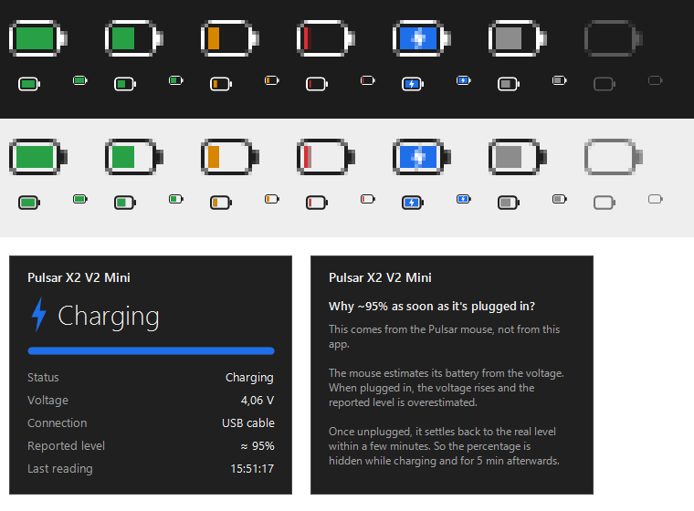

# Pulsar Battery Tray

Shows the battery level of a **Pulsar X2 V2 Mini** mouse in the Windows notification area (next to the clock), with a details window on click.

> **Unofficial** project, not affiliated with Pulsar Gaming Gears. "Pulsar" is a trademark of its owner.



## Features

- **Battery-shaped icon** that fills according to the level: green, then orange, then red. It turns blue with a lightning bolt while charging.
- **Left click**: details window (percentage, status, voltage, connection type, time of the last reading).
- **Right click**: refresh, start with Windows, low battery alert (15%), exit.
- Reads the mouse every 60 seconds and follows the Windows light or dark theme.
- A single `.exe`, nothing else to install on Windows 10 and 11.

## Installation

1. Download `PulsarBatteryTray-Setup-x.y.z.exe` from the [Releases](../../releases/latest) page.
2. Run it and choose the installation type:
   - **Standard**: Start menu shortcut, uninstaller, and a "Start with Windows" option.
   - **Portable**: plain copy to the folder of your choice. Settings are kept in a `portable.ini` file next to the exe and nothing is written to the registry.
3. The icon appears next to the clock. If it is hidden behind the `^` arrow, drag it onto the taskbar.

The installer does not require administrator rights. It is available in English and French.

### "Windows protected your PC" warning

The installer is not code-signed (certificates cost money), so Windows SmartScreen may show this warning. Click **More info**, then **Run anyway**. The full source code is in this repository if you prefer to review it or build it yourself.

## Compatibility

| Hardware | Status |
| --- | --- |
| Pulsar X2 V2 Mini, plugged in over USB | Tested |
| Pulsar X2 V2 Mini, 2.4 GHz wireless receiver | Tested |
| Other Pulsar mice | Not tested |

The app looks for Pulsar devices (USB vendor ID `3554`). Other models using the same protocol may work; feedback is welcome in the *Issues*.

The app is independent from Pulsar Fusion: it talks to the mouse directly and only sends read requests. It never changes the mouse settings.

## Why does the level jump to ~95% as soon as the mouse is plugged in?

This comes from the mouse, not from this app. The mouse estimates its battery from the voltage: when plugged in, the voltage rises and the level it reports is overestimated. Once unplugged, it settles back to the real value within a few minutes.

To avoid showing a misleading number, the app:

- hides the percentage while charging (the reported level stays visible, prefixed with "≈");
- waits 5 minutes after unplugging before showing it again;
- shows "Charged" when the plugged-in mouse reports 100%.

## Reporting a problem

Attach the output of the diagnostic mode to your report. In PowerShell, from the app folder:

```powershell
.\PulsarBattery.exe --once diag.txt
```

The `diag.txt` file lists the detected interfaces and the exchanges with the mouse. It contains no personal information.

## Building from source

No tools are needed for the exe: the script uses the C# compiler that ships with Windows.

```powershell
.\build.ps1
```

To also build the installer (into `dist\`), install [Inno Setup 6](https://jrsoftware.org/isinfo.php) and run:

```powershell
.\build.ps1 -Setup
```

| File | Purpose |
| --- | --- |
| `PulsarBattery.cs` | All of the application code |
| `build.ps1` | Builds the exe and the installer |
| `installer/setup.iss` | Installer script |
| `tools/make-icon.ps1` | Generates `app.ico` |

## Credits

The communication protocol comes from Andrew Rabert's reverse-engineering work in [python-pulsar-mouse-tool](https://github.com/andrewrabert/python-pulsar-mouse-tool) (MIT license).

## License

[MIT](LICENSE)
